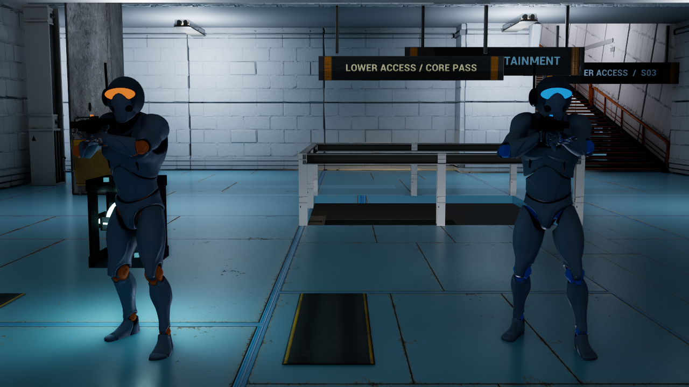

# ARC — erster Operator

ARC verwendet den bereits vorhandenen UE4-Mannequin samt Skeleton und Bewegungsanimationen aus `Content/Meshes/Mannequin`. Der lokale Ordner `Quantum_Modular_Character_Free_Sample-8e200050` enthält nur ein Gewehr-FBX; darin ist kein modularer Charakterkörper vorhanden. Diese Quelldateien werden nicht als vollständiger Operator ausgegeben.

## Darstellung

Spieler und Bots nutzen dieselbe `AVanthexCharacter`-Klasse und die gemeinsame `UVanthexOperatorComponent`. ARC besitzt Graphitpanzerung mit der originalen Normalmap, blaue Teammarkierungen für Alpha und orange Markierungen für Bravo, Helm, Visier, Atemmaske, Funkantenne und ARC-Namensschild. Das Gewehr ist in der Außenansicht zwischen den animierten Händen sichtbar. Die bestehende Waffenansicht bleibt für den eigenen Spieler erhalten; separate animierte Ego-Arme gehören noch nicht zu dieser ersten Version.

Die native Animationsinstanz kombiniert die vorhandenen Stand-, Geh-, Lauf- und Sprunganimationen. Arm-IK führt die Hände zum Gewehr; Hocken passt Becken und Beine an. Tod und Rundenneustart erhalten eine eigene kosmetische Darstellung. Diese Posen verändern weder Schaden noch Bewegungsgeschwindigkeit.

Die bisherigen unsichtbaren Körper- und Kopf-Trefferflächen bleiben für die serverseitige Trefferprüfung erhalten. Sichtbares Skeletal Mesh, Ausrüstung und Gewehr haben keine zusätzliche Kollision. Teamfarbe und Posen werden auf jedem Rechner aus repliziertem Spielerzustand, Bewegung, Blickrichtung und Gesundheit dargestellt.

## Bots und Spielregeln

Offline startet weiterhin ein 3v3: ein menschlicher Spieler und zwei Alpha-Bots gegen drei Bravo-Bots. Bots folgen Wegen, suchen den Core, tragen ihn zur Extraktion und beschießen sichtbare Gegner nach einer Reaktionszeit. Auf einem Server übernehmen zusätzliche Menschen vorhandene Bot-Plätze; beim Verlassen übernimmt wieder ein Bot. Es wird kein zweites, abweichendes Bot-Charaktersystem eingeführt.

ARC bezeichnet den ersten visuellen Operator. Die bestehende Fernhack-Funktion bleibt auf Karten mit aktiven SHIFT-Geräten verfügbar. GRID V3 enthält dafür bislang nur vorbereitete Anschlussstellen; diese Änderung aktiviert dort keine neue Fähigkeit.

## Prüfen

`Run-Operator-Checks.ps1` startet einen begrenzten Testlauf auf GRID V3 und verlangt einen frischen PASS-Bericht in `Saved/OperatorValidation.txt`. Er prüft das tatsächliche 3v3-Aufgebot, Teamfarben, Waffen, Knochenbewegung eines laufenden Bots, Kopf-/Körper-Trefferflächen, Bot-Reaktion, Feindbeschuss sowie Tod und Reset.

Mit `-OperatorShots` auf GRID V3 entstehen acht Kontrollansichten in `Saved/OperatorShots`: Aufstellung beider Teams, Seitenansicht, Helm, Hocken, Messerhaltung, Stich sowie Messer und Gewehr in der Egoansicht. Mit zusätzlichem `-OperatorFirstPersonShots` werden nur die beiden Egoansichten aufgenommen. `-run=VanthexBuildArt -InspectOperator` protokolliert die tatsächlichen Assets und Knochen; `-BuildOperatorArt` erzeugt das ARC-Material anhand der vorhandenen Texturmasken. Die originalen Mannequin-Assets bleiben unverändert.

## Nachweis vom 3. November 2026

| Prüfung | Ergebnis |
|---|---|
| Editor und Game, Win64 Development | Beide Builds erfolgreich |
| Operator und Bots | 32 PASS, 0 FAIL |
| Bestehende Mechaniken | 43 PASS, 0 FAIL |
| GRID-V3-Geometrie und Navigation | 150 PASS, 0 FAIL |
| GRID-V3-Gameplay einschließlich aller Treppen | 34 PASS, 0 FAIL |
| Getrennter Listen-Server und Client | Beide PASS, jeweils sechs initialisierte ARC-Operatoren |
| Gerenderte Kontrolle | Aufstellung, Seitenansicht, Helm und Hocken geprüft |

Der Navigationstest protokolliert echte Bot-Bewegung und Änderungen der Fußpose. Die isolierte Messung entfernt andere eingefrorene Testfiguren aus der Laufstrecke; der geprüfte Bot und die Kartenkollision bleiben aktiv. Schussprüfungen verwenden die tatsächliche KI und serverseitige Treffer. Der Netzwerkfall prüft zwei lokale Prozesse, keine Internet-Latenz oder vollständige 3v3-Balance.

Protokolle liegen in [Validation/OperatorARC](Validation/OperatorARC). Der Armgriff ist eine prozedurale Annäherung an das vorhandene Gewehr; separate Reload-/Fingeranimationen und eigene Ego-Arme sind spätere Erweiterungen.

## Ergänzung: Messer und Waffenwechsel

ARC verwendet jetzt auch das Messer aus dem zusammengeführten Equipment-Branch. `GetPresentation()` berechnet sichtbare Waffe, Absenkung und Stichbewegung aus dem replizierten Zustand und derselben Serveruhr. Weltmodelle und Hand-IK folgen diesem Zustand. Die Ego-Waffe ist nur für ihren Besitzer sichtbar (`OnlyOwnerSee`), das am Operator befestigte Weltmodell für andere Betrachter (`OwnerNoSee`). Übernimmt ein Bot eine Figur mit ausgewähltem Messer, wechselt er zurück zum Gewehr.

Der kombinierte Stand besteht beide Builds mit UE 5.8.3, 64 Gameplay-/Equipment-Prüfungen, 34 Operator-Prüfungen, die GRID-Geometrieprüfung, 34 GRID-Gameplay-Prüfungen sowie die getrennten GRID- und Equipment-Host-/Client-Prüfungen. Acht Kontrollansichten wurden erzeugt; Messerhaltung, Stich sowie Ego-Messer und Ego-Gewehr sind visuell geprüft. Die ursprünglichen ARC-Nachweise oben bleiben als historischer Stand erhalten. Aktuelle Nachweise: [Validation/EquipmentMerge](Validation/EquipmentMerge); Verhalten und Steuerung: [Waffenausrüstung](WEAPON_EQUIPMENT.md).

Separate Ego-Arme, endgültige Messer-Grafik und eigene Messersounds sind weiterhin offen. Wirtschaft, Rüstung und erweitertes Waffen-Audio liegen als Designentwürfe vor.
